# Dirección visual — propuesta para elegir (T081)

**Elección de Dennys:** ______ (A / B / C) · Fecha: ______

Las tres propuestas son el mismo sitio con distintas variables de color y tipografía (`src/styles/tokens.css`). Elegir una es cambiar ese archivo; no toca la estructura. Las capturas son del sitio real con el resultado de la demo abierto (datos de ejemplo), en móvil (390×844) y escritorio (1280×800).

> Aviso de método: las probé en un navegador real, pero **no** corrí la skill `design` completa (investigación de referencias, imágenes propias). Si prefieres que lo haga, dilo y la ejecuto sobre la dirección que elijas.

Todas cumplen el contraste WCAG 2.2 AA en texto normal (la A pasó axe en e2e; B y C usan pares con contraste mayor de 4,5:1 por diseño, pero **axe aún no se ha corrido sobre B ni C**).

| | A · Editorial sereno (actual) | B · Papel técnico | C · Terminal sobrio |
| --- | --- | --- | --- |
| Idea | Oscuro, un acento ámbar; la demo es lo único que brilla | Claro, aspecto de documento; confianza y claridad para quien lee mucho | Oscuro verdoso, titulares en monoespaciada; aspecto de ingeniería |
| Fondo / texto | `#101214` / `#e9e7e2` | `#f6f3ec` / `#1d1b17` | `#0c0f0d` / `#dfe7df` |
| Acento | ámbar `#f2b04a` | azul `#0b5a8f` | lima `#9be564` |
| Tipografía | sans del sistema; mono solo en datos | titulares en serif (Georgia); resto sans | titulares y botones en mono |
| Riesgo | Parecida a muchos sitios "dark" | Menos "tecnológica" a primera vista | Puede leerse como "hacker", que la spec evita (§6) |
| Mi recomendación | **Mantener** (cumple §6: sereno, un solo acento) | Buena alternativa si el público es más de RR. HH. | La menos alineada con §6 |

## Capturas

| | Hero móvil | Demo móvil | Hero escritorio | Demo escritorio |
| --- | --- | --- | --- | --- |
| A | 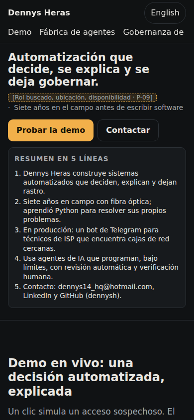 | 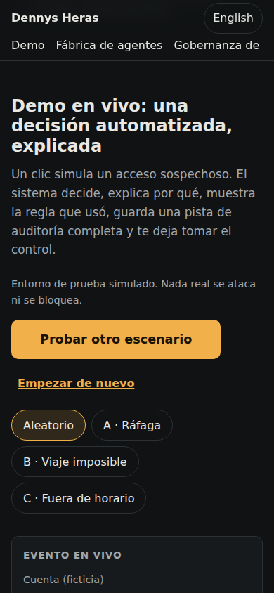 | 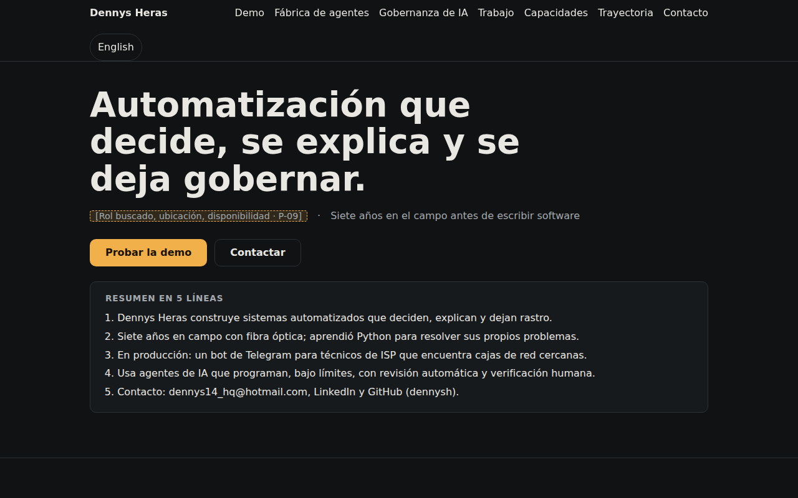 | 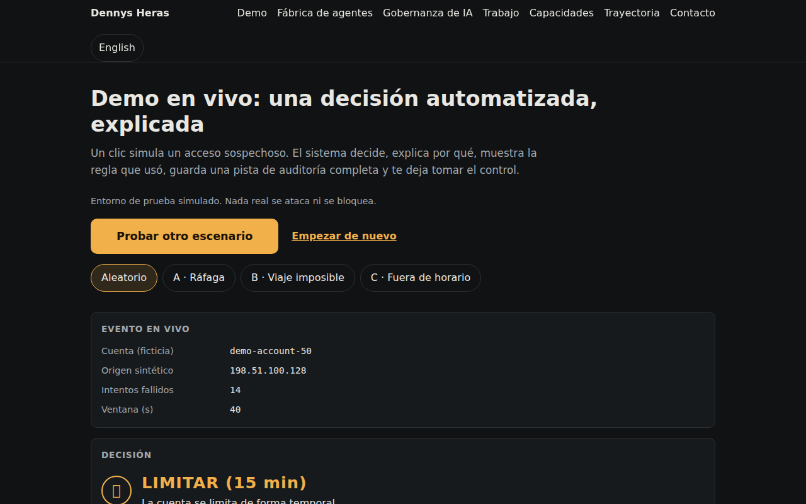 |
| B | 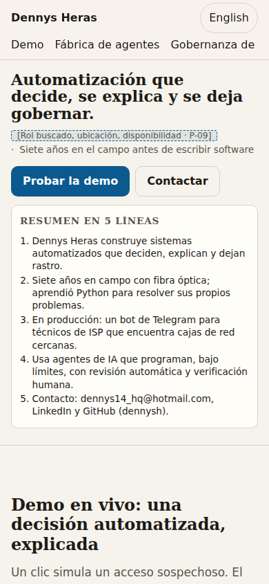 | 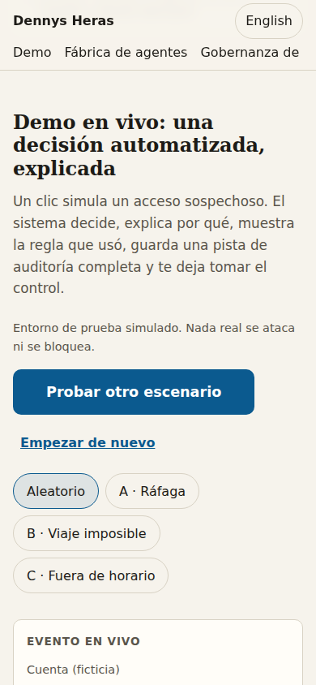 | 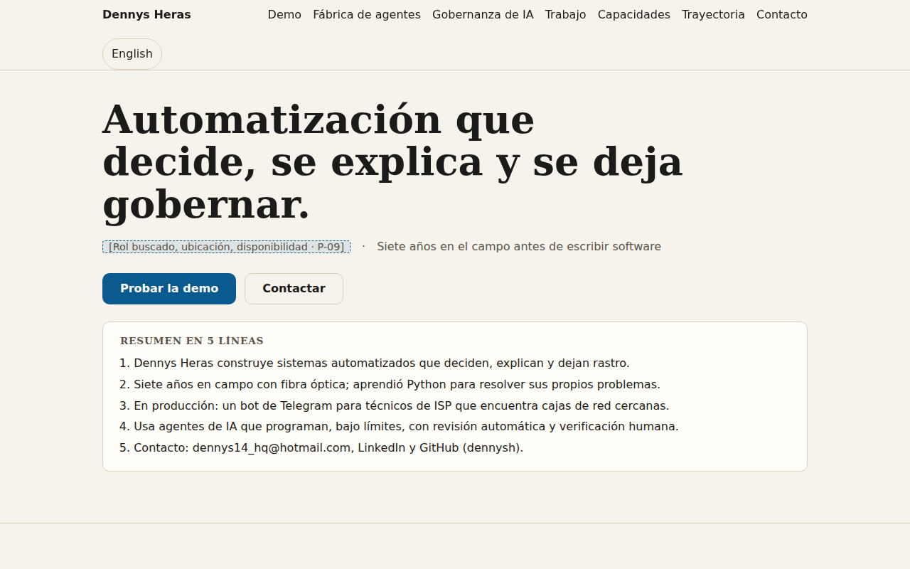 | 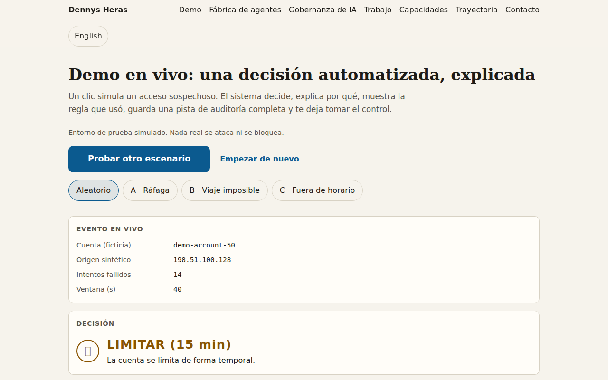 |
| C | 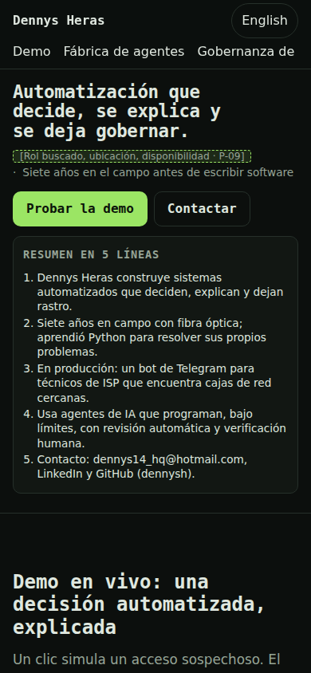 | 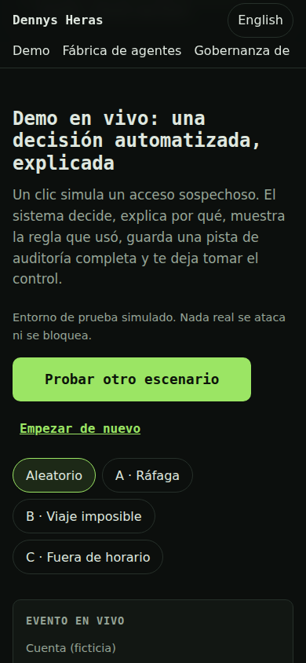 | 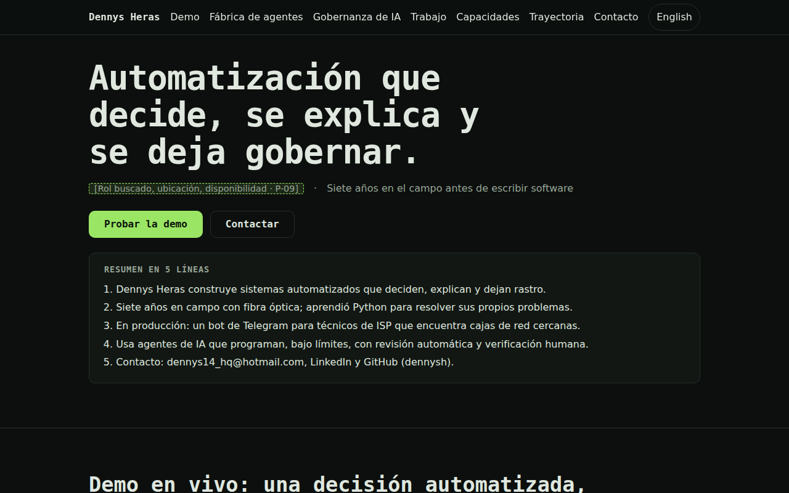 | 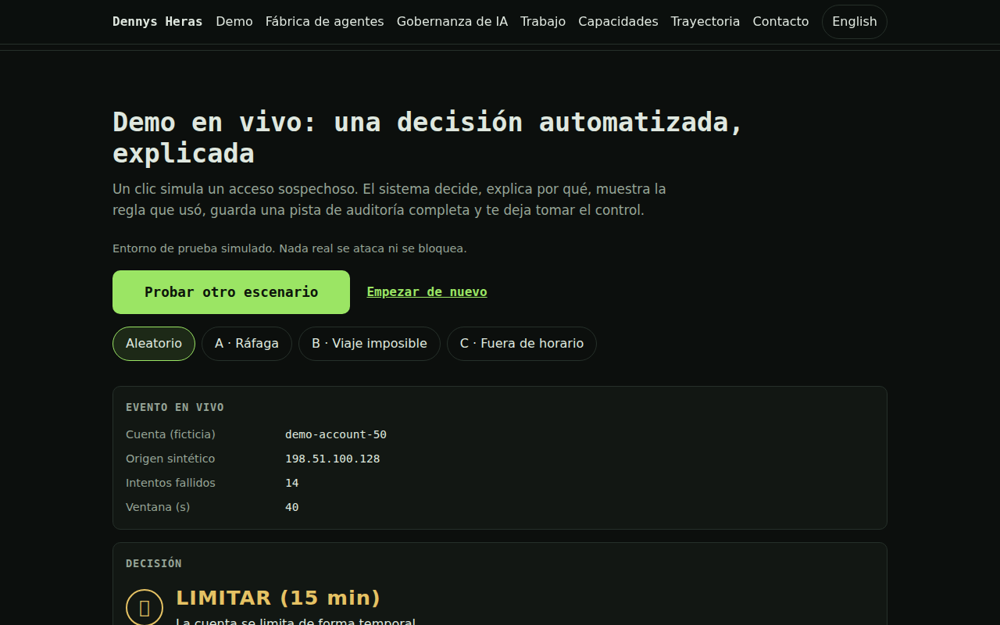 |

## Variables de cada dirección

```css
/* B · Papel técnico */
:root{--bg:#f6f3ec;--surface:#fffdf8;--text:#1d1b17;--muted:#5a554b;--line:#d8d2c4;--accent:#0b5a8f;--accent-ink:#ffffff;--accent-soft:rgba(11,90,143,.1)}
h1,h2{font-family:Georgia,"Times New Roman",serif;font-weight:600}

/* C · Terminal sobrio */
:root{--bg:#0c0f0d;--surface:#121713;--text:#dfe7df;--muted:#97a597;--line:#26302a;--accent:#9be564;--accent-ink:#0c140a;--accent-soft:rgba(155,229,100,.12)}
h1,h2,h3,.brand,.btn{font-family:var(--font-mono)}
```
